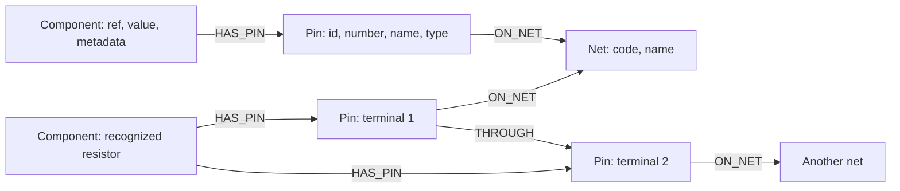

# CircuitDoctor

**Find wiring problems, follow connections, and check whether a revised circuit fixes them.**

Upload a KiCad `.net` file to explore a circuit drawing, inspect supported wiring
warnings, trace a route between pins, and ask Gemini questions grounded in the
connections stored in **FalkorDB**. Upload a corrected file to see which warnings
cleared and which wires changed.

Built for [Graph Hacks: Context for AI Agents](https://www.wemakedevs.org/hackathons/falkordb),
**Track 01 — Agents That Act on Connected Data**.

CircuitDoctor checks the wiring described in a file. It is not a circuit simulator,
and a result with no warnings does not certify that hardware is safe or working.

[Live website](https://circuitdoctor.up.railway.app/) ·
[Run locally](#run-with-docker) · [Try the test circuits](#try-it-without-kicad) ·
[Graph model](#how-falkordb-does-the-work) · [Queries](#queries-the-product-runs) ·
[Supported checks](#what-works) · [Development](#develop-locally)

## Try it online

Open **[CircuitDoctor](https://circuitdoctor.up.railway.app/)** — no local
installation or API key is needed. Upload your own KiCad `.net` file, or download
the test-circuit ZIP from the landing page to try the faulty and corrected files.
Gemini chat is enabled on the hosted app, subject to available API quota.

## Run with Docker

Install Git and Docker with Docker Compose, and start the Docker engine. No local
Python, Node.js or KiCad installation is needed to run the website.

```bash
git clone https://github.com/n0y0nD/CircuitDoctor.git
cd CircuitDoctor
docker compose up -d --build --wait
```

Open **http://localhost:8080**. The first build downloads dependencies and builds
the TypeScript frontend. On Linux, prefix Docker commands with `sudo` if your
installation requires it. For an existing checkout, skip cloning.

Upload your own UTF-8 KiCad S-expression `.net` file (up to 10 MiB). In KiCad's
Schematic Editor, use **File → Export → Netlist** and choose the KiCad format.
Images, Gerbers, `.kicad_sch`, `.kicad_pcb`, XML and SPICE are not supported inputs.

### Try it without KiCad

Download and extract [the test-circuit ZIP](frontend/public/downloads/circuitdoctor-test-circuits.zip),
or use **Download test circuits (.zip)** on the landing page. It contains an
Arduino Uno, a resistor and an LED in two generated KiCad-format netlists, plus
`START-HERE.txt`. These use the same upload, review and comparison code as your own files.

1. Upload **01-wiring-issue.net**. An extra wire joins +5V directly to GND;
   the review shows a short warning. Click **Show me** to highlight it in red.
2. Open **More → Trace a connection**. Select Arduino A1 **+5V** and LED D1
   **A (anode)** to follow the route through R1. The route model stops at the
   LED's pin; it does not trace through the LED internally.
3. With Gemini configured, ask **“Is the connection right?”** or
   **“How is Arduino +5V connected to the LED anode?”**
4. Close the trace if open. Choose **Upload updated file** in the warning panel
   (also available as **More → Check an updated file**) and upload
   **02-corrected-wiring.net**. The short warning should clear with no new warnings.
5. Use **Show old wiring**, **Show updated wiring**, and the earlier/updated
   circuit buttons to inspect the evidence. Fault evidence is red; changed-wire
   evidence is green. The header identifies the file currently on the canvas.
6. Ask **“What changed, and did my fix work?”** while the comparison is open.
   The chat receives a fresh comparison of both saved uploads.

The corrected file removes the extra short; it does not establish LED ratings,
current limits or physical operation. No KiCad installation is needed for this walkthrough.

<details>
<summary>Optional: configure Gemini when running locally</summary>

These instructions are for running your own copy. On a hosted instance with
Gemini configured by its operator, visitors do not need to supply an API key.

Create an API key in [Google AI Studio](https://aistudio.google.com/apikey), then run:

```bash
docker compose exec app python -m circuitdoctor.configure_gemini
```

Paste the key at the hidden prompt. It is stored in the persistent
`gemini_config` volume with owner-only permissions, outside the image and Git.
The next chat request reads it; no restart is needed. Upload, review and connection
exploration work without a key. Each person running their own copy supplies a key.

If you already configured this checkout locally, import its existing key instead:

```bash
docker compose exec -T app python -c 'import os; from circuitdoctor.configure_gemini import KEY_FILE; import sys; fd=os.open(KEY_FILE, os.O_WRONLY|os.O_CREAT|os.O_TRUNC, 0o600); os.fchmod(fd, 0o600); f=os.fdopen(fd, "w"); f.write(sys.stdin.read()); f.close()' < .gemini-api-key
```

Alternatively, Compose accepts `GEMINI_API_KEY` and `GEMINI_MODEL` from the shell
or an ignored root `.env` file. The default model is `gemini-3.5-flash-lite`.
The key stays on the backend. Chat sends the conversation and circuit facts to
Google; API availability and quota depend on the project/model. See
[Google's pricing and data-use table](https://ai.google.dev/gemini-api/docs/pricing).

</details>

### Stop, restart and troubleshoot

```bash
docker compose ps
docker compose logs --tail=50 app falkordb
docker compose stop
docker compose up -d --wait
```

`docker compose down` also keeps saved circuits and the configured key. Do not
add `--volumes` unless you intend to delete both. After changing application
source, use `docker compose up -d --build --wait` to rebuild it.

If a published port is already occupied, stop the conflicting service or change
the host port in `compose.yaml`. Website: 8080; database: 6379; database viewer: 3000.

## What works

- Each uploaded circuit gets its own FalkorDB graph, reconstructed through Cypher
  as **Component → Pin → Net**. Refreshing its URL reloads the saved circuit.
- An interactive circuit view shows parts, exact exported pins, movable components
  and adjustable wires. Components and Connections tabs also expose the data.
- Review finds unmarked single-pin connections and direct power-to-ground or
  different nominal-voltage rail conflicts for identified **Uno R3 / classic Nano**
  symbols. Findings include the relevant connections and board specification sources.
- Required power/GND checks use exact, source-backed part identities in
  `circuitdoctor/required_parts.json` (currently ER-OLEDM0.91-1 I2C OLED and
  LCD-016N002L). FalkorDB checks each required pin’s wire neighbours and routes
  to known Arduino rails/ground. A required pin with no connected peer gets a
  warning and pin evidence; other supply arrangements remain unverified.
  Corrected uploads are checked independently. Supply-voltage review compares the ER-OLEDM0.91-1 I2C OLED’s documented 3–5V operating range against direct nominal Uno/Nano rails with a common board ground reference. It does not propagate voltage through parts. LCD-016N002L remains unverified because its symbol does not identify the 3V/5V variant. Unknown supplies, conflicting metadata and unknown parts stay unverified; an in-range nominal supply does not prove operation or signal compatibility.
- I2C checks match the exact ER-OLEDM0.91-1 I2C symbol's SDA/SCL pins to
  Uno R3 / classic Nano hardware I2C pins through FalkorDB wire routes. Missing,
  crossed or joined signals are reported with evidence. Software I2C and paths
  through intermediate components are not verified.
- External pull-up inspection searches signal → one recognized two-pin resistor →
  known board rail in FalkorDB. A positive resistor value establishes a candidate
  path, not suitable sizing or logic voltage. No external route does **not** prove
  missing pull-ups: module/internal resistors are not modeled.
- Direct power tracing shows pins sharing a known board rail. It stops at parts;
  it does not treat a resistor or common ground as a proven power dependency.
- **Check an updated file:** click **Upload updated file** in the warning panel,
  or **More → Check an updated file**, then **Choose updated .net file**. Both uploads are reviewed from FalkorDB;
  results separate resolved, persistent, new and unverified warnings, with before/after
  wiring highlights. Connection groups are matched by component references and pin IDs,
  so net renaming alone is not a wiring edit. Removed/renamed components, changed part
  identities or lost pin metadata prevent a confirmed repair verdict. Required supply,
  voltage and I2C fixes need a positive supported recheck, not just an absent warning.
  This checks supported warnings only; it does not prove hardware operation.
- **Trace a connection:** choose any two exported pins in your uploaded circuit.
  FalkorDB computes a bounded `shortestPath` over `ON_NET` and derived resistor
  `THROUGH` edges. The UI lists the steps and highlights only route memberships.
  Resistor passages require exact `Device:R` / `Device:R_Small` identities and two
  exported pins; MCU, display, diode and other internal paths are not inferred.
  Searches stop at 32 graph edges with a five-second query timeout. No route is
  not a fault verdict, and a route does not prove current flow or operation.
  Resistor links are created during upload. Existing saved graphs are upgraded
  once at app startup without changing their original wiring. Route requests
  only read the database. If preparation fails, restart the app to retry.
- **Separate groups:** review runs FalkorDB `algo.WCC` on `Component`, `Pin`
  and `Net` nodes using `HAS_PIN` / `ON_NET`. Groups without an identified
  Arduino are shown as information with whole-group highlighting. Without a
  supported board, separate groups are reported without choosing a main group.
  This is structural grouping, not conduction or power-dependency analysis;
  intentional isolated circuits are not declared faulty. Gemini can inspect
  the groups through `check_rules`.
- Gemini calls `circuit_overview`, `explain_net`, `check_rules`, `trace_power`
  and `find_path`.
  The API retains graph evidence and queries; the website shows readable
  connection details and highlights, without raw queries or JSON. Requests are
  bounded to five model calls/eight tool calls, with quota errors returned without automatic retries.

Other component connections are retained, but unknown parts do not inherit guessed
voltage/current limits. A review without warnings does not prove that hardware
works. Firmware, soldering, component health, general GPIO voltage compatibility,
current consumption and required pull-ups are not verified. This is not a simulator.

The included Docker Compose setup binds published ports to loopback for local use.
The hosted demo runs on Railway with FalkorDB on a private network. The app has no
user accounts or per-user access controls; anyone with a saved circuit URL can
view that upload.

## How FalkorDB does the work

Each upload creates a separate graph named `circuitdoctor_<id>`. Reloading a
saved circuit reads that graph; the drawing is a view of its exported connections.



| Graph element | Meaning |
| --- | --- |
| `Component` | A part from the uploaded file, identified by its reference. |
| `Pin` | An exported pin. Its `id` is the JSON-encoded pair `[component reference, pin number]`; exported numbers can differ from labels such as D13. |
| `Net` | A shared wire connection from the netlist, identified by its exported code. |
| `HAS_PIN` | Component ownership, **not** an electrical path through the component. |
| `ON_NET` | A pin's membership in a wire connection. |
| `THROUGH` | A derived passage between the two exported pins of an exact `Device:R` / `Device:R_Small` resistor. It does not mean a zero-ohm wire. |
| `Circuit` | A separate metadata node holding the upload ID, filename, original design metadata, fingerprint and preparation state. |

[Storage](circuitdoctor/storage.py) creates the nodes, indexes and memberships.
[Path preparation](circuitdoctor/path_model.py) adds resistor passages once during
upload; startup upgrades older saved graphs when necessary. Path requests are read-only.

FalkorDB executes the multi-hop path search, connected-components algorithm and
supported supply/I2C/pull-up relationship queries. Python applies catalog-backed
rules to the returned facts, formats warnings and compares the two reviews.
The before/after matching itself runs in Python; it is not presented as a graph algorithm.

### Queries the product runs

These are the application queries, with parameters supplied by the backend.
Source links point to their implementations.

**Find a route between two pins — [`paths.py`](circuitdoctor/paths.py)**

```cypher
MATCH (a:Pin {id:$start}),(b:Pin {id:$end})
WITH shortestPath((a)-[:ON_NET|THROUGH*0..32]-(b)) AS route
RETURN nodes(route), relationships(route)
```

`$start` and `$end` are stored `Pin.id` strings, encoded by the backend from the
selected component reference and exported pin number. The undirected traversal
follows `ON_NET` and `THROUGH` for at most 32 edges, with a five-second query timeout.
It returns the actual nodes and relationships used for step lists and highlights.
Other component internals are excluded; no route is not automatically a fault.

**Find separate circuit groups — [`isolation.py`](circuitdoctor/isolation.py)**

```cypher
CALL algo.WCC({nodeLabels:['Component','Pin','Net'],
  relationshipTypes:['HAS_PIN','ON_NET']}) YIELD node, componentId
WITH node, componentId WHERE 'Component' IN labels(node)
RETURN componentId, collect(node.ref)
```

FalkorDB computes weakly connected components. Python identifies which returned
groups contain a recognized Arduino and builds informational findings for separate
groups. `HAS_PIN` is included for structural grouping, so this is not a conduction
analysis. Without a recognized board, no group is assumed to be the main circuit.

**Inspect external I2C pull-up paths — [`pullups.py`](circuitdoctor/pullups.py)**

```cypher
UNWIND $pins AS id
MATCH (p:Pin {id:id})
OPTIONAL MATCH (p)-[:ON_NET]->(sn:Net)<-[:ON_NET]-(a:Pin)<-[:HAS_PIN]-(r:Component)-[:HAS_PIN]->(b:Pin)-[:ON_NET]->(rn:Net)<-[:ON_NET]-(s:Pin)
WHERE r.ref IN $resistors AND a.id <> b.id AND sn.code <> rn.code AND s.id IN $anchors
RETURN p.id, collect(DISTINCT CASE WHEN r.ref IS NOT NULL
       THEN [r.ref, a.id, b.id, s.id, sn.code, rn.code] ELSE null END)
ORDER BY p.id
```

`$pins` selects catalog signal pins, `$resistors` selects recognized two-terminal
resistor references, and `$anchors` selects identified board-rail pin IDs.
The query traverses from a signal net through a resistor to a supply net. Python
checks the returned rail roles and explicit resistor values. Hidden module pull-ups,
resistor sizing and working I2C communication are not inferred.

### How Gemini uses graph evidence

1. The backend reads the selected circuit from FalkorDB and runs a fresh review
   before asking Gemini to answer. If a comparison is active, it also recomputes
   the earlier/updated comparison and identifies which file is currently displayed.
2. Gemini can call `circuit_overview`, `explain_net`, `check_rules`, `trace_power`
   and `find_path` to investigate further. The backend executes fixed tools with
   validated arguments; the model does not execute arbitrary Cypher.
3. Tool results carry graph facts, queries and evidence nodes/edges. Gemini uses
   those facts to explain connections and supported warnings; the interface exposes
   readable connection details and highlights instead of raw JSON.

The agent uses Gemini function calling, not an MCP server. Requests are limited
to five model calls and eight tool calls. The model explains the deterministic
checks; it does not decide their pass/fail results, edit the schematic or inspect
physical hardware. Implementation: [`chat.py`](circuitdoctor/chat.py),
[`review.py`](circuitdoctor/review.py), [`compare.py`](circuitdoctor/compare.py).

## Inspect FalkorDB

Open **http://localhost:3000**. Use host `127.0.0.1`, port `6379`, no credentials
and no TLS in the included Browser. The app container itself uses host `falkordb`.
Read the `circuit=<id>` value from the uploaded circuit URL fragment. Choose the matching
`circuitdoctor_<id>` graph in FalkorDB Browser:

```cypher
MATCH (c:Component)-[:HAS_PIN]->(p:Pin)-[:ON_NET]->(n:Net)
RETURN c, p, n
```

The existing `circuitdoctor_falkordb_data` volume is retained. AOF persistence
is enabled with a one-second sync interval.

## Develop locally

Requires Python 3.12 and Node.js 24 (the version used by the Docker build). Start only the database
when using the Python/Vite development servers:

```bash
docker compose up -d --wait falkordb
python3 -m venv .venv
source .venv/bin/activate
python -m pip install -r requirements-dev.txt
python -m uvicorn circuitdoctor.api:app --host 127.0.0.1 --port 8000 --reload --reload-dir circuitdoctor
```

In another terminal:

```bash
cd frontend
npm ci
npm run dev
```

Open **http://localhost:5173**. The Vite server proxies API requests to port 8000.
For a local built preview, run `npm run build` in `frontend`, then restart the
Python API and open **http://localhost:8000**.

For local Gemini setup, run `.venv/bin/python -m circuitdoctor.configure_gemini`.
The backend reads `GEMINI_API_KEY`, or `.gemini-api-key` in the repo root.
`GEMINI_API_KEY_FILE` can override the file path for both setup and reading.
For a local API process, `.env` is not automatically loaded.
Database environment overrides: `FALKORDB_HOST`, `FALKORDB_PORT`,
`FALKORDB_USERNAME`, `FALKORDB_PASSWORD`; default is `127.0.0.1:6379`.

### Checks

From the repo root with the virtual environment activated:

```bash
CIRCUITDOCTOR_TEST_DB=1 python -m unittest discover -s tests -v
node --test --test-isolation=none frontend/tests/*.test.mjs
npm --prefix frontend run build
```

Without `CIRCUITDOCTOR_TEST_DB=1`, database integration tests are skipped.
Integration tests create and delete only their own temporary graphs. Automated
chat tests mock the external model while exercising its tool calls; they do not
spend Gemini quota.

`tests/fixtures/kicad/` contains KiCad-exported Uno/Nano normal and shorted wiring
for automated regression checks. The downloadable ZIP is a separate, generated
Arduino/resistor/LED pair for trying the normal upload flow; no circuit-specific
backend shortcut is used.

Latest validation on 18 October 2026: **142 Python tests** with a real FalkorDB,
**88 frontend tests**, and the production frontend build passed. Automated chat
tests mock Gemini; live chat and the earlier/updated wiring flow were also checked
manually during development.

The parser also runs without a database:

```bash
python -m circuitdoctor path/to/circuit.net --json
```

## API

- `GET /api/status`: parser and database readiness.
- `POST /api/parse`: parse a netlist without saving it to FalkorDB.
- `POST /api/circuits?filename=circuit.net`: upload raw UTF-8 `.net` bytes.
- `GET /api/circuits/{id}`: read the saved circuit.
- `POST /api/circuits/{id}/review`: deterministic connectivity and board-rail checks.
- `POST /api/circuits/{id}/explain`: inspect a connection.
- `POST /api/circuits/{id}/power-trace`: trace a direct board rail.
- `POST /api/circuits/{id}/path`: trace a route using `from_ref`, `from_pin`, `to_ref`, `to_pin`.
- `POST /api/circuits/{id}/compare`: recheck two uploads using `{ "corrected_id": "..." }`.
- `POST /api/circuits/{id}/chat`: ask Gemini using `{ "message": "...", "history": [] }`; optional `comparison` carries `original_id` and `corrected_id`.
- `GET /api/chat/status`: whether chat has a configured key (never returns it).

Explain/trace accept JSON containing `net_code`, `net_name`, or both `ref` and
`pin`. Use exact exported pin IDs, which can differ from board labels such as D13.
Interactive API documentation is at **http://localhost:8080/docs**.

## Stack and AI assistance

- Frontend: TypeScript, Vite, Cytoscape.js and custom component artwork.
- Backend: Python, FastAPI and the FalkorDB Python client.
- Storage and graph algorithms: FalkorDB 6.0.2, with Docker volume persistence.
- Circuit assistant: Gemini, configured with a backend-only API key.

Built with help from AI coding assistants, including OpenAI Codex and Claude Code,
for implementation, UI design, debugging, tests and documentation. Runtime circuit
answers use Gemini with graph/tool evidence. The project author is responsible for
reviewing the work and its limitations.
